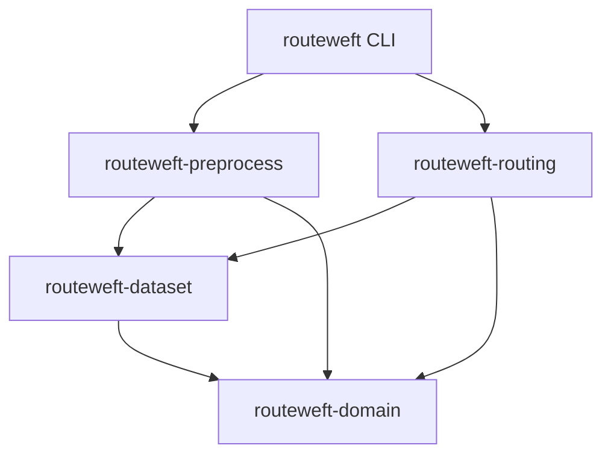

# RouteWeft 架构

领域层不依赖文件、序列化或网络。dataset 定义受控的磁盘契约；preprocess 离线构建；routing 加载并持有不可变图、空间索引与限制自动机。依赖不反向指向 CLI；公开工具没有真实消费者模型、数据库或私有仓库依赖。各 crate 继续 `unsafe_code=forbid`。

CLI 当前在 daemon 进程入口协调构建、检查与查询，输出 JSON；历史南北向端口、旧应用用例和替身测试保留但不承担新的磁盘查询入口。以后引入 HTTP 时应通过新的通用用例协调，不能将用户、设备、租户或发布状态加入内核。

数据图以相邻 OSM 节点为有向边，不按几何交叉推断连接。限制编译为禁止边序列，再构建带 failure links 的前缀自动机。查询状态为 `(位置, 限制状态, 下一个途经点)`，因此途经点不会清空转向历史。查询 overlay 只拆分少数候选道路，原图保持只读。

R-tree 使用数据集纬度范围中点的局部等距圆柱平面；候选段投影后以球面距离排序。默认 city 档位的吸附使用同一平面，经/纬跨度分别不超过 5°；显式 regional 档位允许各 10°，吸附改用查询点纬度的局部投影，索引搜索采用保守包络。纬度范围为 [-85°,85°]，不支持跨日期变更线。该近似不承诺测绘精度。空间索引在加载时重建，不持久化运行时内存结构。

查询不启动线程；宿主提供每次查询的预算、deadline 和 AtomicBool 取消标记，负责线程数与排队。工作计数、状态数、队列和结果几何均有限；硬 RSS 上限由部署环境另行限制。输入按格式及解析器上限拒绝。

持久格式及详细决策见 [ADR 0002](adr-0002-dataset-and-routing.md)、[数据集格式](dataset-format.md)。旧 [ADR 0001](adr-0001-routing-prototype.md) 和 [原型记录](routing-prototype.md) 是历史阶段说明，不是当前公共 API。
